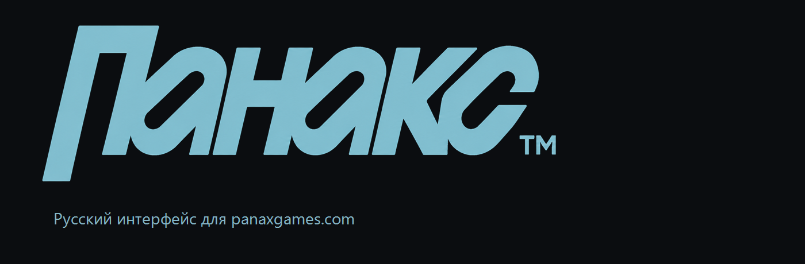
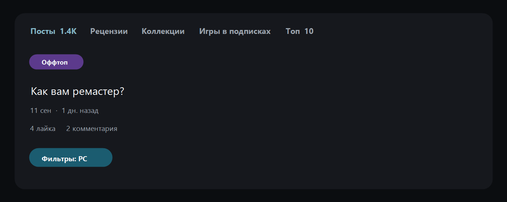
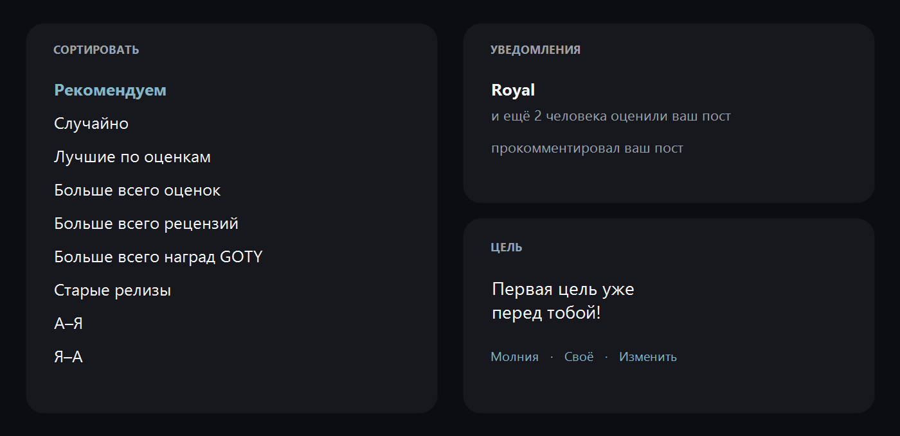
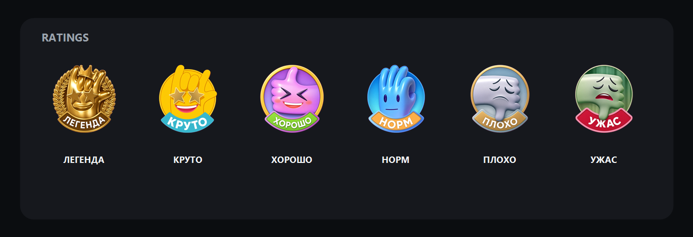

<p align="center">
  <a href="./README.md"></a>
  &nbsp;
  <a href="./README.en.md"></a>
</p>

<p align="center">
  
</p>

<p align="center">
  <a href="https://panaxgames.com">panaxgames.com</a>
  &nbsp;·&nbsp;
  Chrome MV3
  &nbsp;·&nbsp;
  offline, no reload
</p>

A Chrome extension that turns the [PANAX](https://panaxgames.com) interface into Russian as soon as it is installed. The dictionary ships inside the extension. Posts, reviews, comments, and game titles stay in the author’s language.

## What it looks like

Feed tabs, post labels, dates, and filters.

<p align="center">
  
</p>

Sort menu, notifications, and short labels.

<p align="center">
  
</p>

Rating icons with Russian ribbons. These are the same files the extension swaps in on the site.

<p align="center">
  
</p>

## What is translated

- header, sidebar, buttons, and profile tabs
- dates, counts, and notifications: the name stays, the action becomes Russian
- post labels, sort options, and platform filters
- the avatar editor and the Russian **Панакс** wordmark
- ratings: Легенда, Круто, Хорошо, Норм, Плохо, Ужас

Platform names stay as on the site: PC, PS4, Xbox One, and the rest.

## Install

```bash
npm install
npm run build
```

Chrome → `chrome://extensions` → Developer mode → **Load unpacked** → the `dist` folder.

Open [panaxgames.com](https://panaxgames.com). A `PANAX RU` badge in the bottom-right shows the build. After a dictionary change, run `npm run build` again, press Reload on the extension, then Ctrl+Shift+R on the site.

## Dictionary

| File | Role |
| --- | --- |
| `src/locales/ru.json` | English phrase → Russian text |
| `src/locales/en.json` | the same phrases in English |
| `ai/README.md` | how to change a string without breaking layout |
