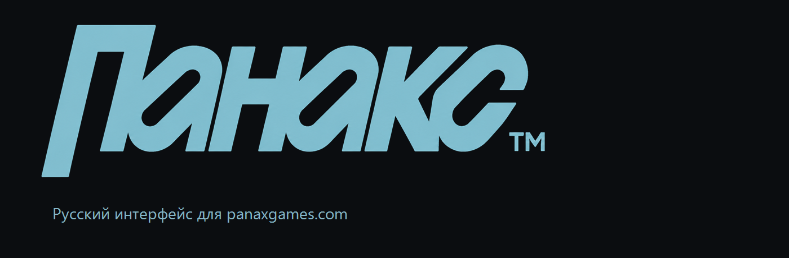
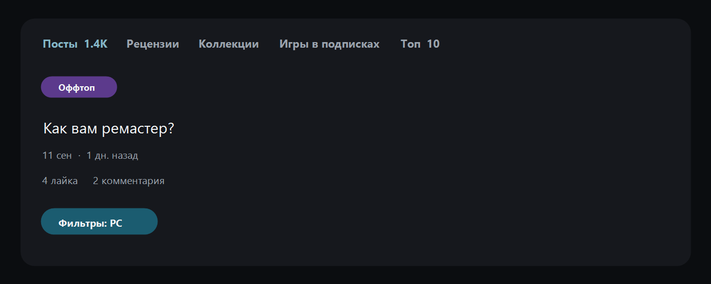
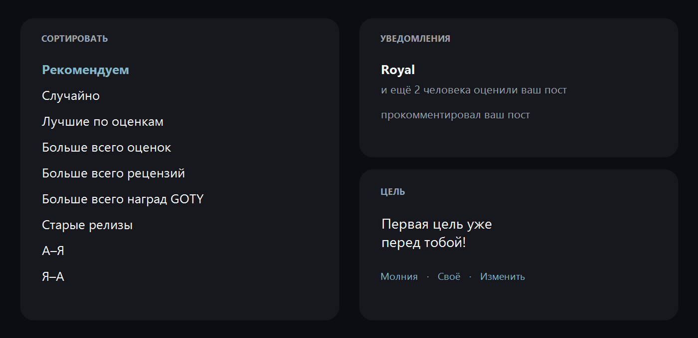
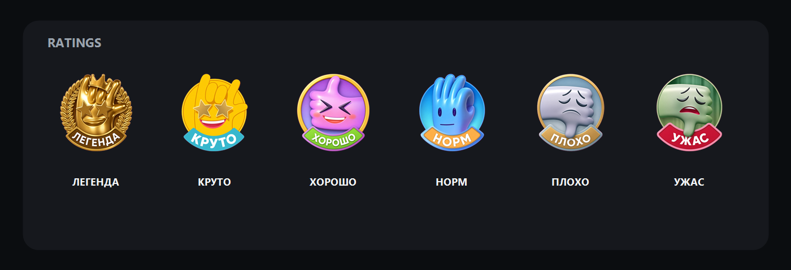

<p align="center">
  <a href="./README.md"></a>
  &nbsp;
  <a href="./README.en.md"></a>
</p>

<p align="center">
  
</p>

<p align="center">
  <a href="https://panaxgames.com">panaxgames.com</a>
  &nbsp;·&nbsp;
  Chrome MV3
  &nbsp;·&nbsp;
  без сети и без перезагрузки
</p>

Расширение переводит интерфейс [PANAX](https://panaxgames.com) на русский сразу после установки. Словарь лежит внутри расширения. Посты, рецензии, комментарии и названия игр остаются как написал автор.

## Как выглядит

Лента, ярлыки, даты и фильтры.

<p align="center">
  
</p>

Сортировка, уведомления и короткие подписи.

<p align="center">
  
</p>

Иконки оценок с русскими лентами. Это те же файлы, которые расширение подставляет на сайт.

<p align="center">
  
</p>

## Что переводится

- шапка, боковое меню, кнопки и вкладки профиля
- даты, счётчики и уведомления: имя остаётся, действие становится русским
- ярлыки постов, сортировка, фильтры платформ
- редактор аватара и русский знак **Панакс**
- оценки: Легенда, Круто, Хорошо, Норм, Плохо, Ужас

Платформы не переводятся: PC, PS4, Xbox One и остальные названия остаются как на сайте.

## Установка

```bash
npm install
npm run build
```

Chrome → `chrome://extensions` → режим разработчика → **Загрузить распакованное расширение** → папка `dist`.

Откройте [panaxgames.com](https://panaxgames.com). Справа снизу бейдж `PANAX RU` с номером сборки. После обновления словаря снова `npm run build`, затем «Обновить» у расширения и Ctrl+Shift+R на сайте.

## Словарь

| Файл | Зачем |
| --- | --- |
| `src/locales/ru.json` | английская фраза → русский текст |
| `src/locales/en.json` | те же фразы на английском |
| `ai/README.md` | как править перевод, не ломая вёрстку |
