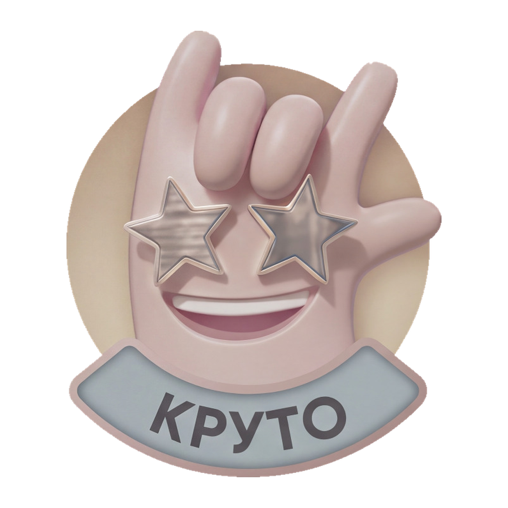

<div align="center">


# PANAX RU — Русский интерфейс, переводы и GameQuill для panaxgames.com


**Полная русификация интерфейса `panaxgames.com`, встроенный переводчик постов и рецензий, кастомные иконки оценок и мощный блочный редактор обзоров GameQuill с 6 дизайнами карточек игр и живой статистикой сообщества PANAX.**

</div>

---

## Что умеет расширение

- **Полная локализация интерфейса**: перевод навигации, профилей, фильтров, уведомлений, дат, модальных окон и плейсхолдеров редактора (`contenteditable` / `data-placeholder`).
- **Перевод постов и комментариев**: кнопка **Translate** прямо в карточках постов, рецензий и комментариев.
- **Обновлённые иконки оценок**: собственные стильные иконки для всех 6 реакций PANAX (до и после нажатия).
- **Редактор обзоров GameQuill**: блочный редактор с темами (`panax-dark` и др.), вставкой текста, заголовков, цитат, спойлеров, изображений/галерей, видео YouTube, виджетов Steam, Мастерской Steam и карточек игр.
- **Живые рейтинги PANAX**: автоматическая подгрузка обложек, студий, издателей, жанров и реальных процентов реакций с `panaxgames.com` как для игр из поиска PANAX, так и для игр, найденных через Steam.

---

## Иконки оценок PANAX

В расширении заменены стандартные иконки реакций для всех 6 уровней оценки:

| Реакция | До нажатия (`-off`) | После нажатия (`-on`) | Цвет в виджетах |
| :--- | :---: | :---: | :--- |
| **Легенда** |  |  | `#f3cb16` |
| **Круто** |  |  | `#f2a000` |
| **Хорошо** |  |  | `#bd55e9` |
| **Норм** |  |  | `#3c9df3` |
| **Плохо** |  |  | `#8ea6af` |
| **Ужас** |  |  | `#e34d68` |

---

## 6 дизайнов карточки игры в GameQuill

При вставке игры в обзор можно выбрать стиль карточки в выпадающем списке **«Дизайн карточки»**:

| Вариант | Название | Описание стиля |
| :--- | :--- | :--- |
| `classic` | **🃏 Классика** | Тёмная карточка с обложкой, тегами жанров, оценками и кнопками источников |
| `duet` | **🎭 Дуэт** | Светлая бумажная карточка `#f0eee8` с обложкой и двумя главными реакциями сообщества с PNG-бейджами через `+` |
| `editorial` | **📰 Вердикт** | Газетная вёрстка `#e9e5dc` с водяным знаком-кругами, крупным блоком лидера и 2-колоночной таблицей остальных реакций |
| `staircase` | **📊 Лестница** | Вертикальная диаграмма-лестница из 6 цветных столбцов с процентами над каждым уровнем |
| `type` | **🔤 Типографика** | Журнальный постер `#faf9f5` с крупным двухцветным заголовком в `Impact` и горизонтальными шкалами |
| `brutal` | **⬛ Брутализм** | Белый двухколоночный блок с жёсткой чёрной рамкой `4px`, постером, оранжевым лидером и моноширинной таблицей |

---

## Установка в Chrome / Edge / Brave

1. Скачайте репозиторий или распакуйте `panax-ru.zip`.
2. Откройте `chrome://extensions/` в браузере.
3. Включите **Режим разработчика** (Developer mode) в правом верхнем углу.
4. Нажмите **Загрузить распакованное расширение** (Load unpacked) и выберите папку `PanaxGamesRu`.
5. Откройте [panaxgames.com](https://panaxgames.com) и обновите страницу.

---

## Разработка и сборка

Проект использует `esbuild` для сборки исходников из `src/` в бандлы расширения:

```powershell
# Установка зависимостей
npm install

# Сборка content-main.js, content.js и gamequill/bridge.js
npm run build

# Режим наблюдения (watch)
npm run watch

# Упаковка готового архива panax-ru.zip
npm run pack
```

### Структура репозитория

- `manifest.json` — конфигурация Chrome-расширения (Manifest V3).
- `src/content/` — контент-скрипты перевода, обогащения и рендера виджетов (`render.js`, `render.css`).
- `src/gamequill/` — мост `window.GQ` (`bridge.js`, `bridge-core.js`) для поиска и загрузки данных PANAX / Steam.
- `src/shared/` — общая схема данных (`gq-schema.js`), демо-данные (`gq-demo.js`), санитайзер, темы и кодирование.
- `gamequill/` — редактор обзоров (`app.js`, `app.css`, `index.html`, собранный `bridge.js`).
- `ratings/` и `icons/` — графические ресурсы и иконки оценок.
- `designs/` — HTML-прототипы виджетов и исходные ассеты.
- `ai/` — документация и чек-лист для ИИ-ассистентов ([ai/README.md](ai/README.md)).
